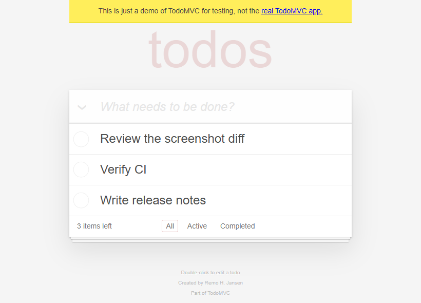
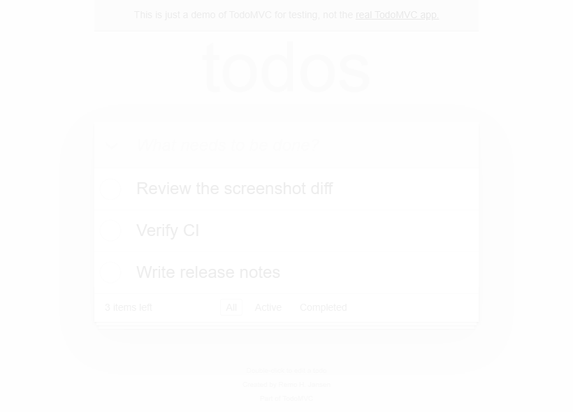
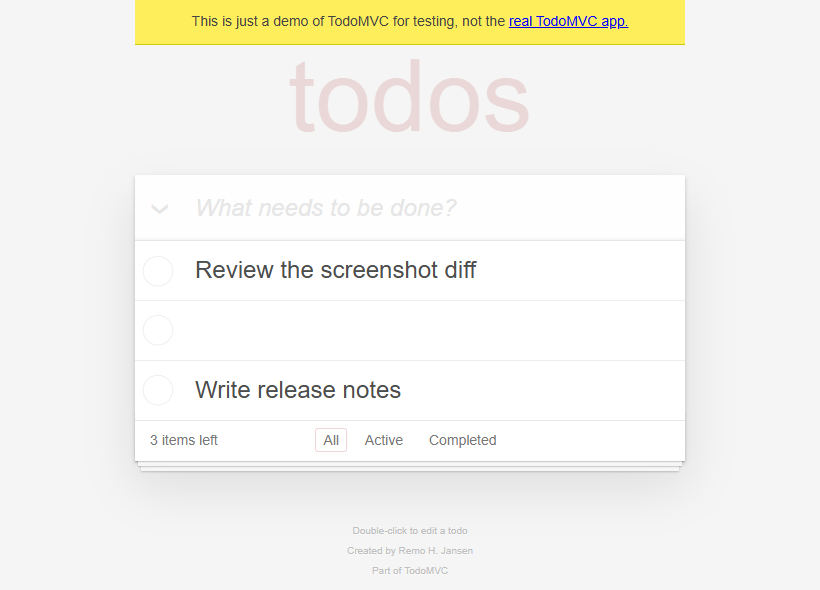
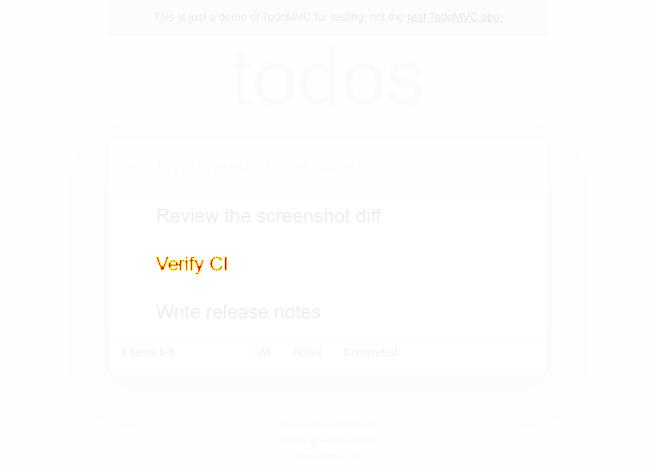
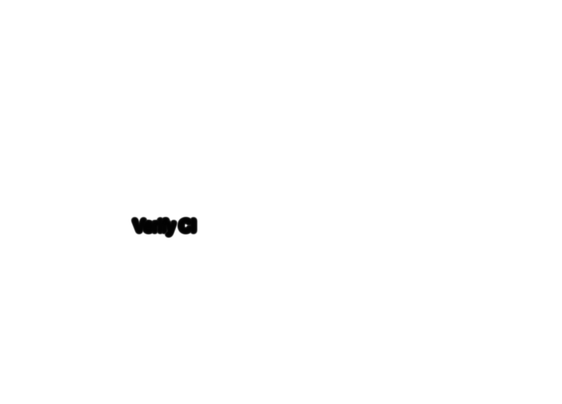

# TodoMVC 截图回归案例

同一浏览器中对比 TodoMVC 的原始界面、选中筛选按钮的边框变深，以及一行待办文字消失。页面为 Playwright 公开运行的测试应用，三条待办由示例脚本录入。两种变化通过浏览器内的样式修改分别模拟。2026-11-11 在 Windows 11、Chrome 157.0.8103.39、Playwright 1.52.0 下捕获，视口为 820×590，设备像素比例为 1。[应用来源](https://demo.playwright.dev/todomvc/) · [截图脚本](capture.py)

[基准截图](before.png)包含三条待办，底部选中 `All`。

| 模拟变化 | 变化后的截图 | 原有像素差异图 | 局部 Gaussian SSIM 图 |
| --- | --- | --- | --- |
| `All` 边框颜色的不透明度从 0.20 改为 0.30 | [](border.png) | [](border-pixel-diff.png) | [](border-ssim.png) |
| `Verify CI` 文字变为透明，保留所在行和复选框 | [](missing-label.png) | [](missing-label-pixel-diff.png) | [](missing-label-ssim.png) |

每行的两种对比图来自同一对 820×590 输入。像素差异图使用 mizchi/pixelmatch 原有默认设置，阈值 0.1，排除检测为抗锯齿的像素，红色标出计入差异的像素。SSIM 使用默认 11×11 高斯窗口、sigma 1.5，白色表示高相似度，较暗位置对应更低的局部相似度。

| 模拟变化 | 像素差异数（阈值 0.1） | 像素差异数（阈值 0.02） | 整体 SSIM | 相似度图最暗灰度（0–255） |
| --- | ---: | ---: | ---: | ---: |
| 筛选边框变深 | 0 | 88 | 0.9998921641 | 237 |
| 待办文字消失 | 241 | 243 | 0.9957593662 | 2 |

- 边框变化在默认像素阈值下未计入差异，SSIM 图在筛选按钮周围形成浅灰轮廓。把像素阈值调至 0.02 后，像素比较也记录到 88 处变化。
- 文字消失时，原有像素差异图直接标出字形，SSIM 图在同一区域变暗。整图得分仍为 0.99576，仅看全局分数容易漏掉占画面面积很小的文字回归。

这组案例展示两种输出在同一视觉回归流程中的用途。像素计数回答固定阈值下有多少像素需要关注，SSIM 图补充变化在局部窗口中的位置和程度。两组受控变化只提供场景证据，实际项目的阈值需用自己的截图校准。

## 复现

使用仓库中固定的截图作为输入。需要 moonc 0.10.20 或更新版本及 Node.js 24。在仓库根目录执行下列命令。

```sh
(
  set -e
  mkdir -p _build/ssim-visual
  cd examples/ssim-visual
  moon update
  for scenario in border missing-label; do
    moon run --target js --release --deny-warn . -- before.png "$scenario.png" \
      "../../_build/ssim-visual/$scenario-pixel-diff.png" \
      "../../_build/ssim-visual/$scenario-ssim.png"
  done
)
```

示例直接调用库里的 `pixelmatch` 和 `ssim`，写出两张 PNG 和一行 JSON。两张 SSIM 图也用仓库的 PNG CLI 核对过，生成文件的 SHA-256 分别一致。[示例代码](main.mbt) · [PNG CLI](../../README.md#compare-two-pngs-from-the-command-line)

如需重拍，在仓库根目录使用已安装 Chrome 的环境运行 `python examples/ssim-visual/capture.py`，脚本依赖 Python 的 Playwright 1.52.0，截图写入 `_build/ssim-visual-capture/`。外部页面版本、浏览器和字体可能影响重新捕获的像素，复现上表以仓库内的截图为准。
